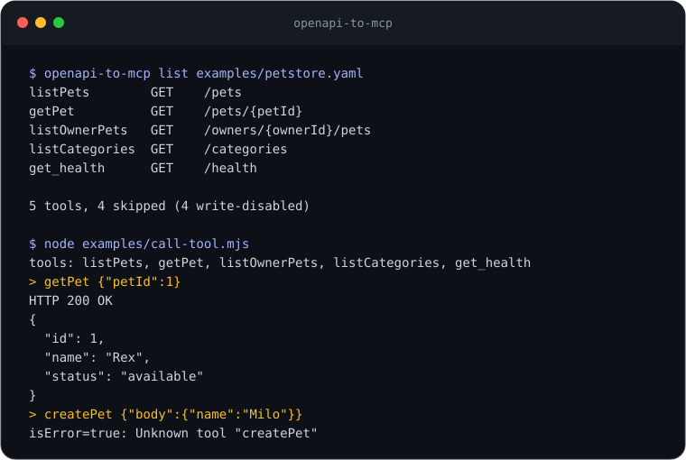

# openapi-to-mcp
[](https://github.com/YusufBeratZengin/openapi-to-mcp/actions/workflows/ci.yml) [](https://www.npmjs.com/package/openapi-to-mcp) [](LICENSE) [](package.json)

[English](README.md) | [Türkçe](README.tr.md)

OpenAPI 3.0/3.1 dosyalarını MCP araçlarına, stdio sunucusuna veya bağımsız bir sunucu projesine dönüştürür.
Spec dosyalarını yerelde okur; tipli kütüphane API’si ve varsayılan olarak salt okunur araçlar sunar, doğrudan yalnızca iki çalışma bağımlılığı kullanır.
Bu kaynak kopyasında Node 24 ile kurulum: `npm ci && npm run build`.
İlk deneme: `node dist/bin.js list examples/petstore.yaml`.


## Demo

```sh
node dist/bin.js list examples/petstore.yaml
node dist/bin.js list examples/petstore.yaml --include 'tag:pets'
node examples/call-tool.mjs
```

İlk komutun çıktısı:

```text
listPets        GET    /pets
getPet          GET    /pets/{petId}
listOwnerPets   GET    /owners/{ownerId}/pets
listCategories  GET    /categories
get_health      GET    /health

5 tools, 4 skipped (4 write-disabled)
```

Son komut örnek bir HTTP API’sini loopback üzerinde başlatır, MCP istemcisini CLI’a bağlar, `getPet` aracını çağırır ve `createPet` aracının kullanılamadığını gösterir. API hesabı veya kimlik bilgisi gerekmez. Terminal görselini [scripts/make-demo.mjs](scripts/make-demo.mjs) üzerinden yenilemek için `npm run demo` kullanılır.

## Kurulum

Kaynak kopyasında `npm ci && npm run build` çalıştırın. Geliştirme araçları Node 22.13+ veya 24+ ister; derlenmiş CLI ve kütüphane Node 20+ ile çalışır. CI, geliştirme kontrollerini Node 22/24 üzerinde, çalışma uyumluluğunu da Node 20 üzerinde denetler.

npm üzerindeki `openapi-to-mcp` adı başka bir projeye ait olabilir; bu oturumda kayıt sahibini doğrulamadık. npm rozeti bu kodun yayımlandığını değil, ilgili kayıt adını gösterir. Paket adı bakımcı tarafından netleştirilene kadar yerel derlemeyi kullanın. Global kurulum gerekmez.

## Kullanım

### CLI

```sh
node dist/bin.js --help
node dist/bin.js list examples/petstore.yaml --allow-write --exclude 'tag:admin'
node dist/bin.js generate examples/petstore.yaml -o is/petstore-mcp
```

`list`, API isteği yapmadan ve kimlik doğrulama değişkenlerini okumadan araçları gösterir. `generate` altı dosya üretir: `server.mjs`, `runtime.js`, `mcp.js`, `tools.json`, `package.json` ve README. Hedefte bu dosyalardan biri varsa üzerine yazmaz; yeni çıktı için boş bir klasör seçin. Üretilen proje manifesti ve çalışma kodunu içerir; çalışırken yalnızca MCP SDK’sına ihtiyaç duyar.

Üretilen sunucuyu başlatmak için çıktı klasöründe bağımlılıklarını kurup `server.mjs` dosyasını Node ile çalıştırın. stdio sunucusu bir MCP istemcisini bekler; stdout yalnızca protokol mesajları, stderr ise tanı mesajları için kullanılır.

MCP istemcisinin stdio ayarları doğrudan derlenmiş CLI’ı kullanabilir:

```json
{
  "mcpServers": {
    "petstore": {
      "command": "node",
      "args": ["dist/bin.js", "serve", "examples/petstore.yaml"]
    }
  }
}
```

Göreli yolları projenin çalışma klasörüne göre çözümleyin veya istemcide kurulumunuza uygun yollar tanımlayın. Örnek spec’teki sunucu adresi temsili olduğundan, gerçek API için `--base-url` gerekir. Varsayılan olarak `GET` ve `HEAD` açılır; desteklenen diğer metotlar `--allow-write` ister.

### Kütüphane

```js
import { loadSpec, buildManifest, createExecutor } from './dist/index.js';

const spec = await loadSpec('examples/petstore.yaml');
const { manifest, skipped } = buildManifest(spec, { include: ['getPet'] });
console.log(manifest.tools.map((tool) => tool.name), skipped.length);
const executor = createExecutor(manifest, {
  env: {},
  fetch: async () => new Response('{"id":1,"name":"Rex"}', {
    headers: { 'Content-Type': 'application/json' },
  }),
});
console.log((await executor.execute('getPet', { petId: 1 })).text);
```

Burada enjekte edilen fetch sayesinde örnek internete çıkmaz. Çalıştırılabilir hâli [examples/library.mjs](examples/library.mjs) dosyasındadır. Özel fetch verilmezse `execute` HTTP isteği gönderir. Sonuç `{ isError, text }` biçimindedir; HTTP 4xx/5xx, zaman aşımı ve istek hataları araç hatası olarak döner.

Paket kökü `parseSpec`, `loadSpec`, `resolveBaseUrl`, `buildManifest`, `matchesPattern`, `deref`, `convertSchema`, `createExecutor`, `createMcpServer`, `generateProject` işlevlerini ve bunların dışarı açılan tiplerini sunar. `createMcpServer(manifest, deps?, info?)` henüz bağlanmamış bir SDK sunucusu döndürür; bir transport’a bağlamanız gerekir. `generateProject(manifest, outDir, options?)`, yazdığı dosyaların adlarını döndürür.

## Örnekler

- [petstore.yaml](examples/petstore.yaml): yerel referanslar, özyinelemeli şemalar, filtreler, JSON ve form gövdeleri içeren OpenAPI 3.0 örneği.
- [call-tool.mjs](examples/call-tool.mjs): gerçek stdio MCP istemcisi ve yerel sahte HTTP API’si.
- [library.mjs](examples/library.mjs): enjekte edilen yanıtla, ağ kullanmadan kütüphane API’si. Derlemeden sonra `node examples/library.mjs` ile çalıştırılır.
- [mini31.json](tests/fixtures/mini31.json): nullable union, ad çakışması ve desteklenmeyen yükleme işlemleri içeren OpenAPI 3.1 örneği.

## Yapılandırma

| CLI seçeneği | Kütüphanede `BuildOptions` | Varsayılan / davranış |
| --- | --- | --- |
| `--base-url URL` | `baseUrl` | Üst düzeydeki ilk `servers` girdisi; değişken varsayılanları kullanılır |
| `--allow-host HOST` | `allowedHosts` | Base URL’nin host’u; tekrarlanırsa listeyi değiştirir |
| `--allow-write` | `allowWrite` | `false`; desteklenen diğer metotları açar |
| `--include PATTERN` | `include` | Tüm işlemler; tekrarlanan desenlerden birinin eşleşmesi yeterli |
| `--exclude PATTERN` | `exclude` | Yok; hariç tutma kuralları önceliklidir |
| `--bearer-env VAR` | `bearerEnv` | Bearer token’ı adı verilen ortam değişkeninden okur |
| `--header-env H=VAR` | `headerEnv: { H: 'VAR' }` | Header değerini adı verilen ortam değişkeninden okur |
| `--timeout MS` | `timeoutMs` | `30000`; `1..2147483647` aralığında tam sayı |
| `--max-response BYTES` | `maxResponseBytes` | `1000000`; pozitif güvenli tam sayı |
| `-o, --out DIR` | `generateProject` için `outDir` | `generate` için zorunlu |
| `-h, --help` / `-v, --version` | — | Yardım / paket sürümü |

Desenler araç adı, asıl `operationId`, `tag:AD` veya `METHOD /path` ile eşleşir. Büyük/küçük harf ayrımı yoktur ve eşleşme tüm metni kapsar; `*` herhangi bir diziyi, `?` tek karakteri karşılar. Shell’in deseni değiştirmemesi için tırnak kullanın.

`OPENAPI_MCP_BASE_URL`, üretilmiş sunucular dâhil executor başlarken base URL’yi değiştirir. Yeni host izin listesinde bulunmalıdır. Port içermeyen bir host girdisi o hostname’in tüm portlarına izin verir; sınırlamak için `hostname:port` kullanın. Yönlendirmeler izlenmeden döndürülür. Base URL, HTTP(S) kullanmalı; kimlik bilgisi, query string veya fragment içermemelidir.

Kimlik doğrulama değerlerini MCP istemcisinin sağladığı süreç ortamına koyun. Seçenekler ve manifestler token değerini değil, değişken **adını** saklar. `Authorization`, `Cookie` ve `headerEnv` ile tanımlanan header’lar araç girdilerinden gizlenir. `X-Api-Key` gibi özel kimlik doğrulama header’larını açıkça yapılandırın; OpenAPI `securitySchemes` otomatik bağlanmaz. Gerekli değişken yoksa sunucu başlangıçta hata verir.

## Nasıl çalışır?

1. Yerel JSON veya YAML dosyasını okur ve yerel JSON pointer referanslarını çözer. Özyinelemeli referanslar açık bir yer tutucu şemaya dönüşür; genişletme için düğüm sınırı vardır.
2. İşlemleri seçer, path ve işlem parametrelerini birleştirir, benzersiz adlar atar ve OpenAPI şema anahtarlarını JSON Schema’ya dönüştürür.
3. Girdi şemalarını resmî MCP SDK’sı üzerinden sunar. Her çağrı path, query, header ve JSON/form gövdesini süre ve yanıt boyutu sınırlı bir HTTP isteğine dönüştürür.

## Sınırlar ve gizlilik

OpenAPI 3.0.x ve 3.1.x desteklenir. Desteklenen metotlar GET, HEAD, POST, PUT, PATCH, DELETE ve OPTIONS’tır. Yalnızca üst düzey sunucu seçimi uygulanır. Uzak referanslar, Swagger 2, callback, link, cookie parametresi, multipart/binary yüklemeler ve OAuth akışları uygulanmamıştır. JSON ve `application/*+json` gövde türleri korunur; form-urlencoded gövdeler desteklenir.

Parametre kodlaması simple path, form query, düz `deepObject` query, boşluk/pipe ayrımlı diziler ve header değerlerini destekler. Matrix/label path stilleri, iç içe deepObject ve parametre `content` kodlamaları tam uygulanmamıştır. Özyinelemeli şemalardaki yer tutucular o kısıtları kaybeder. Şemalar istemciye sunulur; executor zorunlu girdileri kontrol eder, fakat tam JSON Schema doğrulaması yapmaz ve şema varsayılanlarını doldurmaz.

Spec okuma, listeleme ve kod üretimi yereldir. Sunucu çalışırken verilen girdiler ve yapılandırılan kimlik bilgileri seçtiğiniz API’ye gider; API yanıtı MCP istemcisine döner. Hassas veri bağlamadan önce spec’i, hedefi ve istemci izinlerini inceleyin. API yanıtında sır veya kötü amaçlı talimat bulunabilir; yanıtlar maskeleme yapılmadan metin olarak aktarılır. Host izin listesi DNS/IP yalıtımı sağlamaz; GET işleminin de yan etkisi olabilir. Üretilen manifest API URL’sini, yolları ve şema açıklamalarını içerir; paylaşmadan önce inceleyin.

## Geliştirme

Node 24 ve mevcut lockfile’ı kullanın:

```sh
npm run lint
npm run typecheck
npm test
npm run build
npm pack --dry-run --cache ./is/npm-cache
```

Bağımlılıklar yoksa önce `npm ci` çalıştırın. `npm test`, derlemenin ardından Vitest ve V8 kapsam ölçümünü çalıştırır. **Statement, branch, function ve line için ayrı ayrı %85** alt sınırı uygulanır. Testler örnek veri, enjekte edilen fetch veya loopback HTTP sunucusu kullanır; dış API gerekmez. Uçtan uca testler stdio ve üretilen projeleri kapsar. CI, Ubuntu ve Windows üzerinde çalışır. `src/bin.ts`, stdio testlerinde çalıştırılır ancak Vitest’in süreç içi kapsam raporuna dâhil değildir.

## Katkı

[CONTRIBUTING.md](CONTRIBUTING.md), [CHANGELOG.md](CHANGELOG.md), [SECURITY.md](SECURITY.md) ve [Davranış Kuralları](CODE_OF_CONDUCT.md) dosyalarına bakın. GitHub iş akışları CI, CodeQL, haftalık bağımlılık güncellemeleri ve tag ile paket yayımlamayı kapsar. Sürüm çıkarmadan önce bakımcının npm trusted publishing ayarını yapması ve paket adını netleştirmesi gerekir.

## Lisans

[MIT](LICENSE), telif hakkı 2026 Yusuf Berat Zengin.
